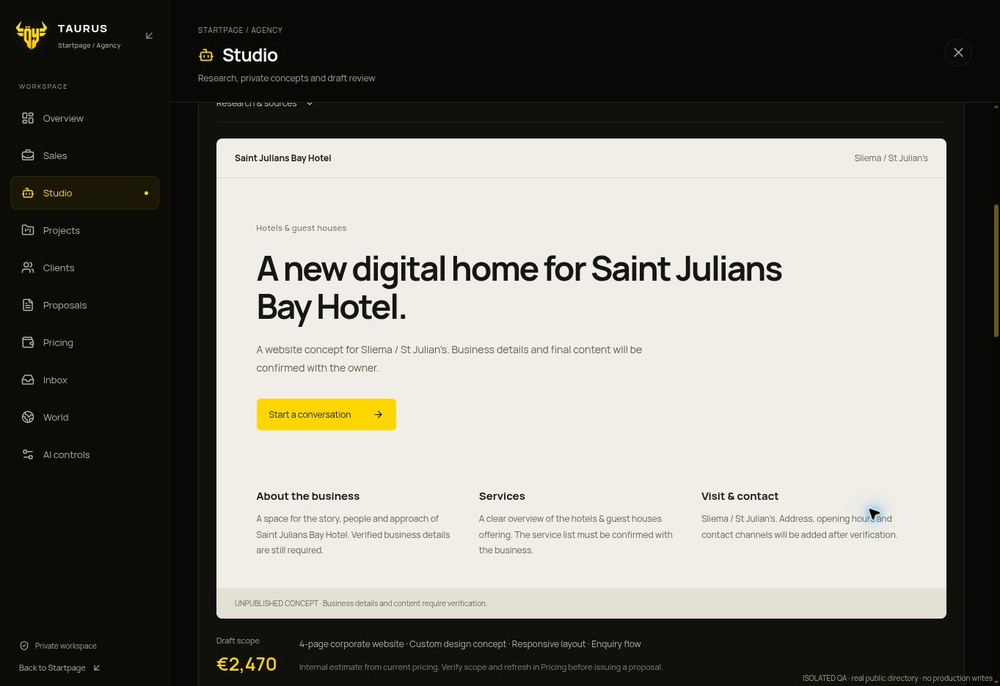

# Discovery failure correction · 11 November 2026

The existing Startpage components and real backend runner were exercised with
live public OSM reads and isolated in-memory persistence. Sliema hospitality
discovery returned three companies and produced two private template concepts
with estimates. The screenshot shows the Saint Julians Bay Hotel concept; it is
an unpublished test preview, with business details still awaiting verification.
No production records, customer messages or public demos were created.

The error/retry flow was also checked with controlled transport timeouts: a
readable failure, disabled retry during the cooldown, then recovery of the same
task. Old generic failures get a readable explanation without inventing a cause.
Sales and Studio retain one section heading. The production build passes.

